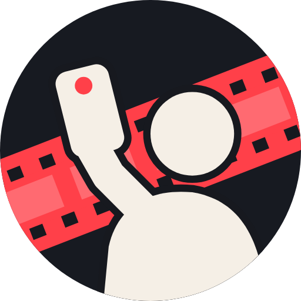
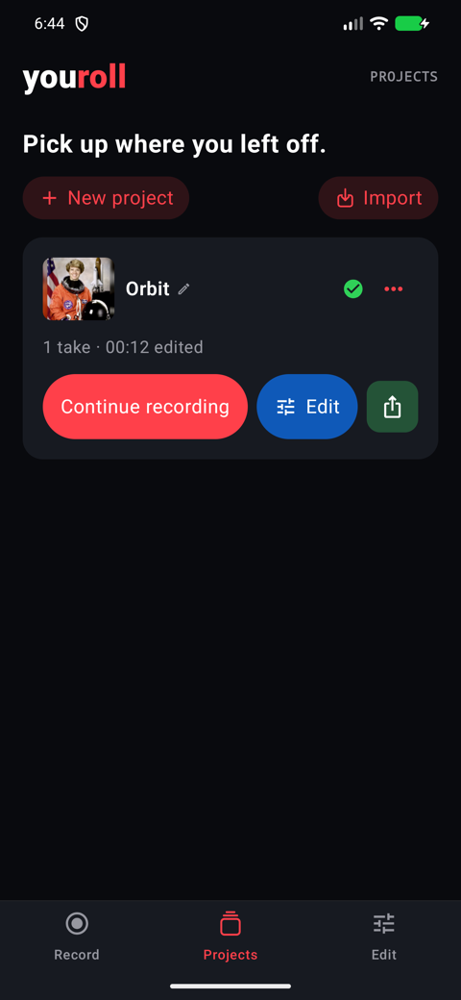
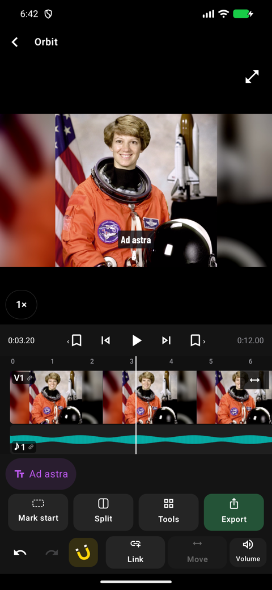
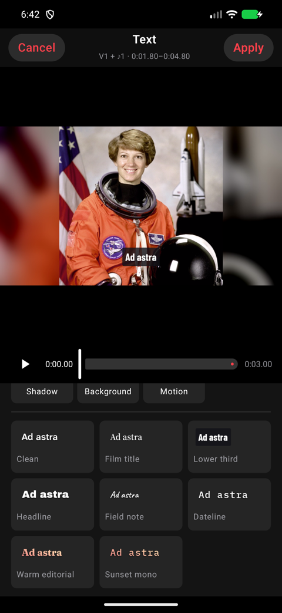
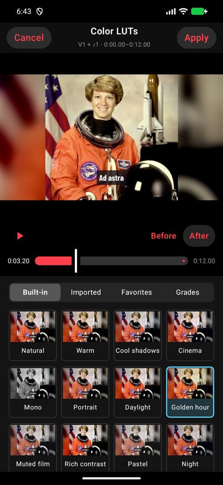
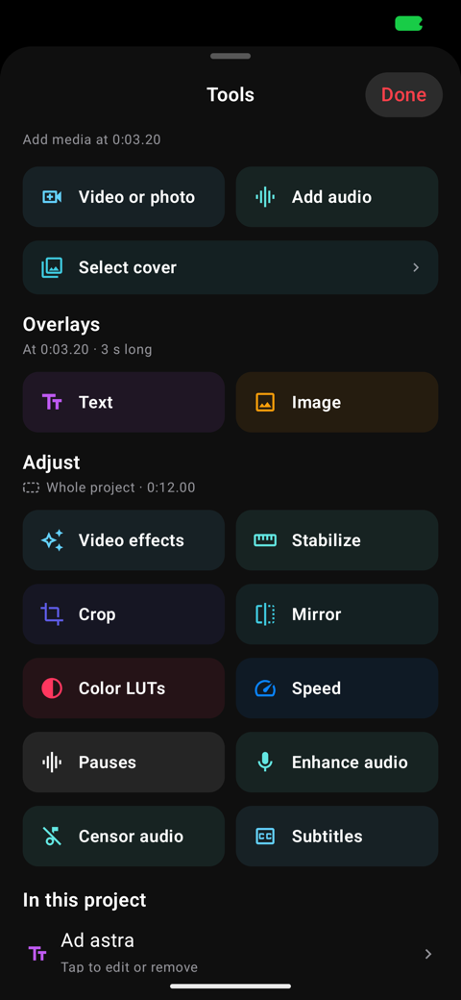

<h1 align="center">YouRoll</h1>

>Note: This app, including the README.md are AI generated.

YouRoll is an Android port of [YouRec](https://github.com/antirez/YouRecApp), the camera and
multitrack video editor for iPhone by Salvatore Sanfilippo
([antirez](https://github.com/antirez)). It aims at feature parity with YouRec: the same
recorder, the same editor and the same tools, with the same logic and the same interface,
adapted to Android only where the platform requires it.

**All credit goes to antirez.** The design, the features, the interface and the original
code are his. YouRoll translates his Swift app into Kotlin, file by file, and keeps his
project format so the two can converge. If you use an iPhone, use
[YouRec](https://github.com/antirez/YouRecApp) itself. The story behind it, and
the reference manual, are in
[its README](https://github.com/antirez/YouRecApp#readme).

  
  
  
  
  

Projects · Editor · Text · Color LUTs · Tools. Sample picture: NASA portrait of
astronaut Eileen Collins (public domain).

## What works

- **Recorder:** record, pause and resume into one project, switch cameras and lenses
  mid-take, zoom presets and ramps, focus, the microphone of your choice, landscape.
- **Editor:** split, trim, move, copy and paste, undo and redo that survive a restart.
- **Tools:** crop and shape presets, speed, titles, transitions, picture-in-picture, images,
  mirror, pause removal, censor, added audio, cover picker, colour looks and LUTs, video
  effects, stabilization, audio enhancement and subtitles transcribed on the phone.
- **Export:** H.264/AAC MP4, Share, Save to gallery.

What is not ported yet, and why, is listed in [android/TODO.md](android/TODO.md). The
biggest gaps are the effects and models that only exist for Apple platforms, and recorder
extras such as dual-camera recording.

## Build

The Android app lives in [android/](android). See [android/README.md](android/README.md) for
requirements, build commands, the emulator setup and the test suites. YouRoll is open source
and installed by sideloading; it is not on the Play Store.

## Repository layout

- `android/`: the Android app (Gradle project, scripts, tests).
- `docs/`: the icon and the screenshots shown here.
- `ThirdParty/`: code and data the build uses, each with its licence: RNNoise, the title
  fonts, the DeepFilterNet3 DSP settings, and `YouRec/`, the motion estimator from YouRec
  (`StabilizationMotion.cpp`) with its tests and a synthetic test video.

## Licence and names

YouRec is MIT-licensed, and so is YouRoll; see [LICENSE](LICENSE) and
[THIRD_PARTY_NOTICES.md](THIRD_PARTY_NOTICES.md). antirez reserves the **YouRec name and
icon**, so this port uses its own name and icon.
